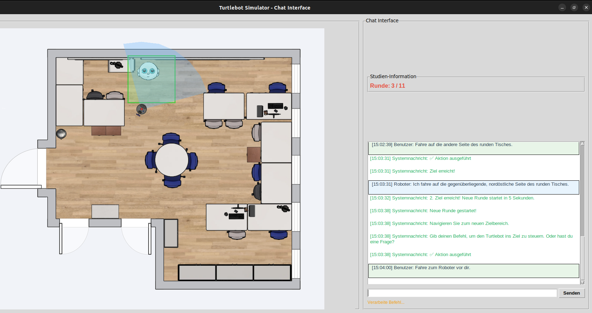
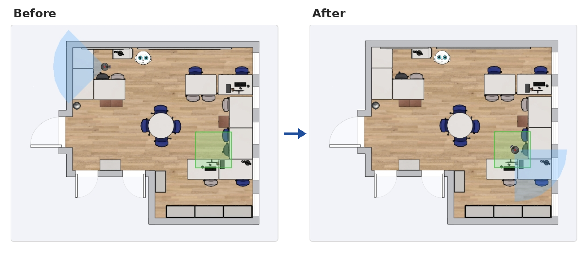
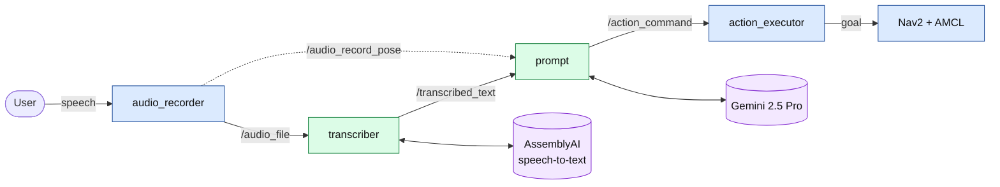
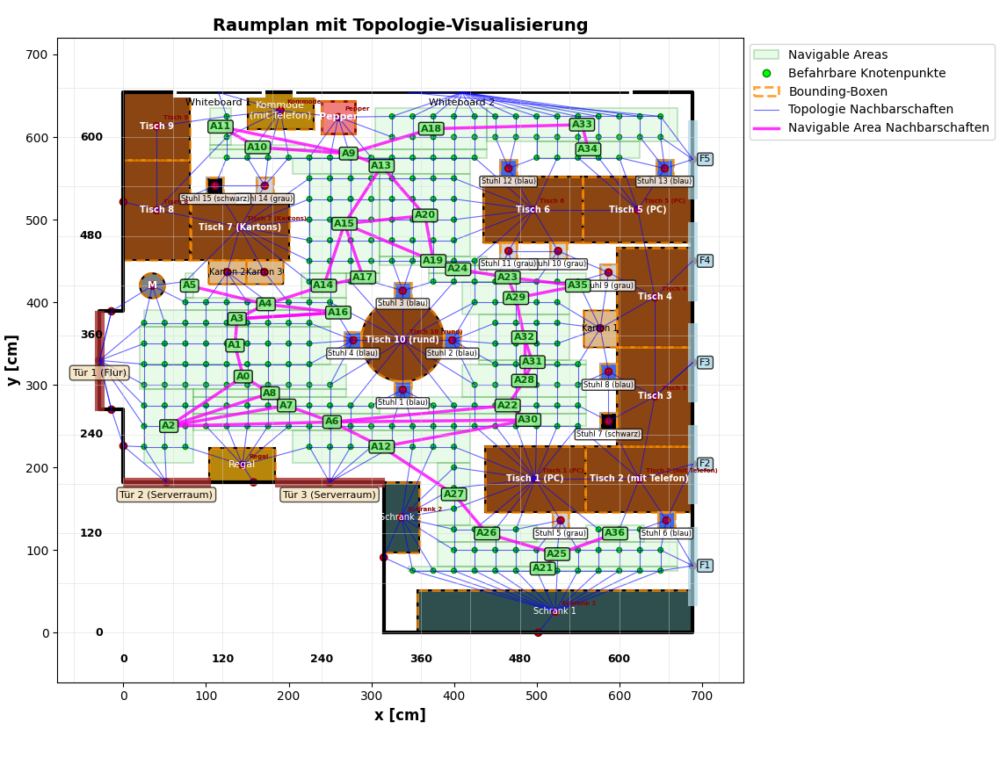

# Context-Aware Voice Control for TurtleBot 4

**Tell a mobile robot where to go the way you'd tell a person:**
*"Drive past the round table, then into the corner."*

This ROS 2 system turns spoken, context-dependent navigation commands into goals for a TurtleBot 4. A multimodal LLM (Gemini 2.5 Pro) interprets each command using a semantic map of the room and the robot's own perspective (what is in front of it, to its left, to its right).


<!-- TIP: replace this screenshot with a short GIF of the --sim mode (record with Peek or OBS, ~10 s) -->

*Simulation used in the user study: room plan with the robot and its field of view (left), chat with the robot (right).*

> Bachelor's thesis, University of Lübeck, Institute for Information Systems, 2025
> Supervisor: Prof. Dr.-Ing. Nele Rußwinkel

---

## What you can say to the robot

The robot understands many kinds of commands, not just "go to X". Commands are given in German; the examples below are translated.

| Command type | Example |
|---|---|
| Go to an object | *"Go to the shelf"* |
| Implicit goal | *"I want to make copies"* → drives to the printer |
| Relative directions | *"Drive one meter to the right"*, *"Go around the corner"* |
| Spatial relations | *"In front of the window"*, *"Between the tables"*, *"Past the table"* |
| Areas | *"Go to the back left corner"*, *"Drive to the middle of the room"* |
| Multi-step paths | *"To the table, then left to the window"* |
| Corrections | *"The other corner"*, *"Go back"* |
| Compass directions and coordinates | *"Drive one meter north-west"*, *"Go to coordinate 100, 320"* |
| Questions and small talk | *"Which objects do you see?"* → answers without moving |

Every time, the robot replies in the chat with what it is doing, e.g. *"I'm driving to the opposite, north-east side of the round table."*

## Example

> **Command:** *"Turn around, then drive right at a 30° angle past the circle of chairs into the corner formed by the tables."*
>
> **Robot:** *"I turn around and then drive diagonally right past the round table with the chairs into the corner formed by the two tables there."*



The LLM answers in a fixed JSON format (ontology). The format forces it to check that the goal lies in a drivable area before the robot moves. Shortened output for the command above:

```json
{
  "Aktion": "Navigieren",
  "Parameter": { "Zielposition": { "x": 550, "y": 260, "z": 0 } },
  "Einheiten": { "Position": "Zentimeter" },
  "verification": { "text": "(550, 260) lies in navigable area 30: x in [420, 560], y in [250, 265]" },
  "explanation": "Ich drehe mich um und fahre dann schräg rechts ...",
  "reasoning": "Multi-step path command with relative directions ..."
}
```

## Results

User study: **15 participants** gave **298 navigation commands** in simulation.

| Metric | Result |
|---|---|
| Critical interpretation error rate | **3.36 %** |
| Success on unambiguous goal commands | **100 %** |
| Valid JSON output (matches the ontology) | **100 %** |
| Usefulness for pick-up and delivery tasks | **4.6 / 5** |
| Comprehensibility of the robot's answers | **4.33 / 5** |

The most common errors were mixing up relative and global directions, e.g. "left" interpreted as "west". Another key finding: good feedback from the robot encouraged users to give more complex commands.

## How it works


*Blue: runs on the TurtleBot (Raspberry Pi 4). Green: runs on an Ubuntu PC. Purple: cloud APIs.*

1. **Perception.** A ReSpeaker mic array records the command, and AssemblyAI transcribes it. The robot's pose comes from AMCL on a SLAM map.
2. **Semantic map.** The room is modelled as a room plan with labelled objects, navigable areas and a topological graph. A *perspective analysis* lists which objects are in front of the robot, to its left and to its right at its current pose.

    
    *Room plan with navigable areas (green), drivable nodes and the topological graph (labels in German).*

3. **Interpretation.** The `prompt` node sends Gemini 2.5 Pro the command, the room plan image, the topological graph (JSON), the perspective analysis and few-shot examples, using chain-of-thought instructions. The answer is a JSON action following the ontology above.
4. **Execution.** The goal is transformed from room-plan coordinates into the SLAM map frame (an affine transform fitted to 3 reference points). The robot then drives there with Nav2.

## Repository structure

| Package | Runs on | Purpose |
|---|---|---|
| `audio_recorder` | TurtleBot | Records speech (ReSpeaker 4 Mic Array, hardware VAD), publishes audio and robot pose |
| `transcriber` | PC | Speech-to-text via AssemblyAI |
| `prompt` | PC | Builds the context-rich prompt, calls Gemini, publishes the action |
| `action_executor` | TurtleBot | Executes the action with Nav2 |
| `chat` | PC | Simulation and chat GUI (replaces voice input and robot for testing) |
| `map` | – | SLAM map, room plan and robot images |

## Quick start: simulation (no robot needed)

**Requirements:** Ubuntu 22.04, [ROS 2 Humble](https://docs.ros.org/en/humble/Installation.html), a [Gemini API key](https://aistudio.google.com/apikey)

```bash
# 1. Clone into a new workspace
git clone https://github.com/Harry100Mark/Context-aware-voice-control-for-the-Turtlebot-4-Standard.git \
    ~/ros2_ws/src

# 2. Install dependencies
sudo apt install python3-tk
pip install google-generativeai assemblyai shapely matplotlib pillow numpy pyaudio pyusb

# 3. Build
source /opt/ros/humble/setup.bash
cd ~/ros2_ws && colcon build
```

Then open **two terminals**. In each one, first run:

```bash
source /opt/ros/humble/setup.bash && source ~/ros2_ws/install/setup.bash
```

| Terminal 1: LLM node | Terminal 2: simulation GUI |
|---|---|
| `export GOOGLE_API_KEY='your-key'`<br>`ros2 run prompt prompt_google2` | `ros2 run chat chat --sim` |

Type a command in the chat window, e.g. *"Fahre auf die andere Seite des runden Tisches"* ("Drive to the other side of the round table").

| `chat` mode | What it does |
|---|---|
| `--sim` | Free chat: give commands and watch the robot move on the room plan |
| `--stu` | Study mode used in the evaluation: random start poses and goal areas, automatic goal checks |
| `--bot` | Type commands in the terminal instead of speaking, for the real robot |

## Running on the real TurtleBot 4

<details>
<summary><b>Show setup</b></summary>

**Requirements:** TurtleBot 4 Standard with ROS 2 Humble, [ReSpeaker 4 Mic Array](https://wiki.seeedstudio.com/ReSpeaker_4_Mic_Array_for_Raspberry_Pi/) connected to the robot, and the robot and PC in the same network via [Discovery Server](https://turtlebot.github.io/turtlebot4-user-manual/setup/discovery_server.html). You also need a Gemini API key and an [AssemblyAI API key](https://www.assemblyai.com/).

**1. Copy `audio_recorder` and `action_executor` to the robot** and build them there (`colcon build`).

**2. Start localization and navigation on the robot** (one terminal each):

```bash
ros2 launch turtlebot4_navigation localization.launch.py map:=$HOME/ros2_ws/src/map/map.yaml
ros2 launch turtlebot4_navigation nav2.launch.py
```

Optional, on the PC: `ros2 launch turtlebot4_viz view_robot.launch.py`

**3. Start the four nodes in this order** (source the workspace in every terminal):

| # | Where | Command |
|---|---|---|
| 1 | Robot | `ros2 run audio_recorder audio_recorder` |
| 2 | PC | `export ASSEMBLYAI_API_KEY='your-key'`<br>`ros2 run transcriber transcriber` |
| 3 | PC | `export GOOGLE_API_KEY='your-key'`<br>`ros2 run prompt prompt_google2` |
| 4 | Robot | `ros2 run action_executor action_executor` |

Now speak a command near the robot. Recording starts only while the robot is standing still.

</details>

## Limitations and future work

- **Latency:** about 66 s per command on average, mostly the Gemini 2.5 Pro API response time
- **Manual environment modelling:** the room plan and topological graph are built by hand for one room
- **2D LiDAR:** obstacles above or below the scan plane (table tops, chair feet) are missing from the SLAM map, so Nav2 keepout zones are planned
- **Evaluation in simulation:** the full voice pipeline runs on the robot, but the study ran in simulation to test interpretation in isolation from localization and speech-recognition errors

## Citation

```bibtex
@thesis{hundertmark2025voice,
  author = {Harry Hundertmark},
  title  = {Context-Aware Voice Control for the TurtleBot 4 Standard: Intelligent Interpretation of Navigation Commands in Familiar Environments},
  type   = {Bachelor's thesis},
  school = {University of Lübeck},
  year   = {2025}
}
```
